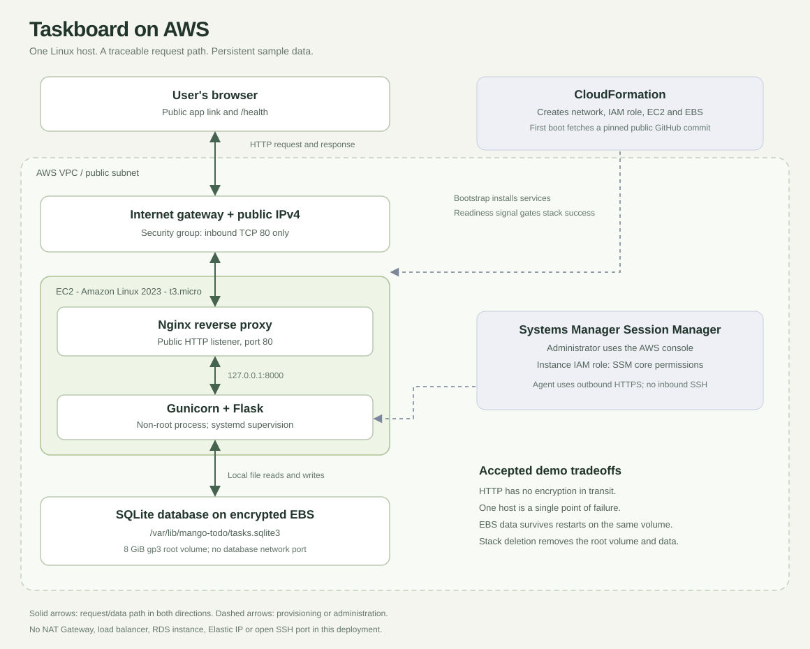
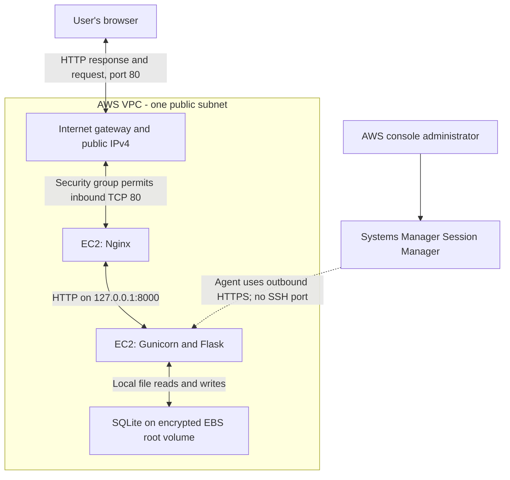

# Taskboard - MangoApps DevOps take-home

A small, shared to-do list designed to make its deployment easy to inspect and explain.
Flask reads and writes tasks in SQLite. Nginx receives public HTTP requests and proxies
them to a non-root Gunicorn process on a Linux EC2 instance.

**New to this project? Follow [START_HERE.md](START_HERE.md).**

## Deployment status

This package is a tested starter, **not an already-deployed AWS submission**.
Before submitting, replace the placeholders below and complete the live acceptance checks.

| Deliverable | Fill in after deployment |
| --- | --- |
| Live app | TODO: public HTTP URL from CloudFormation Outputs |
| Health check | TODO: same URL followed by /health |
| Repository | TODO: your GitHub repository URL |
| Demo video | TODO: your 2-5 minute video URL |
| AWS Region / instance / AMI | TODO: record actual deployed values |
| Deployed commit SHA | TODO: full commit SHA used at launch |
| Cost verification | TODO: account plan, credit balance, budget and review date |

## Run locally

Requirements: Python 3.11 or newer, macOS or Linux.

```bash
python3 -m venv .venv
source .venv/bin/activate
python -m pip install -r requirements-dev.txt
python -m flask --app app:create_app run --host 127.0.0.1 --port 5050
```

Open http://127.0.0.1:5050. The database is created at
`instance/tasks.sqlite3`, which Git ignores. Stop with Ctrl+C.
The Flask development server is for local work. EC2 uses Gunicorn and Nginx.

Run the tests from the project root:

```bash
python -m pytest -q
```

For a local check using the production application server:

```bash
gunicorn --no-control-socket --workers 1 --threads 2 --bind 127.0.0.1:5050 'app:create_app()'
```

## Architecture



Editable diagram: [Mermaid source](docs/architecture.mmd).



The subnet's route table points internet traffic to the internet gateway.
The instance has an automatically assigned public IPv4 address.
Responses return through the same layers. SQLite uses local file I/O; there is
no database server or database network port.

CloudFormation creates the VPC, subnet, route table, internet gateway,
security group, IAM role, instance profile, EC2 instance and EBS root volume.
During first boot, user data fetches the specified public GitHub commit,
installs the application, starts its services and verifies `/health`.
A CloudFormation resource signal reports readiness, rather than treating
an instance that merely booted as a successful app deployment.
Session Manager uses an EC2 instance role with `AmazonSSMManagedInstanceCore`.
The application itself calls no AWS APIs.

## Deploy on AWS

The full console walkthrough is in [START_HERE.md](START_HERE.md).

1. Verify your account plan, eligible services and credits. Configure a cost budget.
2. Push or upload this project's contents to the root of a **public GitHub repository**.
3. Copy the full 40-character commit SHA.
4. In CloudFormation in your chosen Region, create a stack by uploading
   `deploy/cloudformation.yaml`.
5. Supply `GitHubRepository` as `OWNER/REPOSITORY` and `GitCommit` as the SHA.
6. Review the small instance and acknowledge creation of the IAM role.
7. After `CREATE_COMPLETE`, open `AppUrl` and `HealthUrl` from Outputs.
8. Run the live acceptance checks below. Fill in the deployment table above.

This template intentionally supports a public repository and a pinned commit.
A private repository needs a different authenticated delivery method; do not
embed a personal access token in user data. No AWS access keys are needed.

Changing `GitCommit` in an existing stack is **not an application deployment
procedure**: EC2 user data normally runs only on first boot.
For updates, use the explicit procedure in [the operations guide](docs/OPERATIONS.md).

## Choices and tradeoffs

| Choice | Why it fits this demo | Alternative considered and tradeoff |
| --- | --- | --- |
| EC2 t3.micro | Small memory footprint; enough for a light Flask demo. Standard CPU credits avoid surplus-credit charges. | t3.small offers more memory but consumes more budget. Standard credits can throttle sustained CPU load. |
| Amazon Linux 2023 x86_64 | AWS-maintained Linux, native systemd and package support, SSM agent in the standard AMI. | Ubuntu is also suitable; using the AWS image keeps this deployment in one documented package environment. |
| Flask + Gunicorn | Small Python app, production WSGI process, one worker and two threads. | FastAPI would be useful for an API-first service; this app mainly serves forms and HTML. |
| SQLite on EBS | Real SQL persistence without another billable database instance or database credentials. | RDS PostgreSQL has managed backups and better concurrency but adds cost and configuration. This SQLite design is single-host. |
| Nginx + public IPv4 | Direct, inspectable traffic path with only inbound TCP 80. Gunicorn stays on loopback. | An ALB provides TLS termination and multi-instance routing but adds resources and cost. |
| Session Manager | IAM-controlled console shell with no inbound SSH, keys or port 22. | SSH is familiar but would require key management and an inbound rule. |
| CloudFormation (optional extra) | Reproducible networking and host settings; readiness signals catch failed setup. | Manual console provisioning is quick but is harder to reproduce and review. |

HTTP is a deliberate demo limitation: traffic is not encrypted in transit.
Only sample tasks belong here. EBS encryption protects data at rest; it does not
provide HTTPS. Before real users, add a domain, trusted TLS and secure cookies.

## Security

- Only port 80 is open inbound. Ports 22, 8000 and database ports are not exposed.
- Gunicorn runs as `mangoapp`, not root; systemd limits writable paths to the data directory.
- IMDSv2 is required. The instance role has the standard Systems Manager core policy,
  not administrator access. Narrow that managed policy further for a production deployment.
- The root EBS volume is encrypted. The generated session secret lives in a
  root-readable environment file, outside Git and outside user data.
- SQL uses bound parameters; templates escape task titles. Mutations require
  CSRF tokens. Input length, request size and total task count are bounded.
- Nginx adds a small per-IP rate limit. This is not a DDoS protection service.
- This is a shared, unauthenticated demo: anyone who can open it can edit tasks.
  It is not an authorization model for real customer data.
- The secret and database are not committed. Debug mode is not enabled on EC2.

## Health, persistence and operations

`GET /health` returns HTTP 200 with:

```json
{"app":"ok","database":"ok","status":"healthy"}
```

It opens the configured database in read/write-existing mode and queries the
application table. A missing file or missing table returns HTTP 503 with
`database: "unavailable"`. Internal details are logged, not returned publicly.
This checks database readability, not a trial write or all possible disk failures.

On EC2 the SQLite file lives in `/var/lib/mango-todo/tasks.sqlite3`, outside
the source checkout. It survives service restarts, OS reboots, stop/start and
application updates **on the same EBS volume**. It does not survive
instance termination, stack deletion, volume loss or replacement in this template.
The root volume has `DeleteOnTermination: true` to avoid leaving billed storage.
Back up important data before any destructive operation.

systemd starts the app on boot and restarts it after failures. This is process
supervision, not an external uptime monitor. Logs are in journald and Nginx
log files. See [OPERATIONS.md](docs/OPERATIONS.md) for health checks, backup,
updates and troubleshooting.

## Cost

Do not assume `t3.micro` means permanently free. AWS's current new-account
program uses credits and a limited free-plan duration; older accounts follow
different rules. Verify the offer shown in **your own account** before launch.
Review the live regional price and credit expiration, then record your findings.

The billable components here are EC2 hours, one 8 GiB gp3 volume, public IPv4
hours and any billable data transfer. At the published USD 0.005/hour public
IPv4 rate, 730 hours costs USD 3.65 before eligible allowances or credits.
The CPU credit mode is `standard`, so there are no T3 Unlimited surplus-credit
charges. There is no NAT Gateway, load balancer, RDS instance or Elastic IP.
Credits may cover eligible usage; the template itself cannot guarantee a zero bill.

Set a small monthly cost budget with email alerts; consider excluding credits
from its cost calculation so it can alert while usage consumes credits.
Budgets can lag and **do not automatically stop spending**.
Check remaining credits and actual costs while the app is running.

Keep the app running until MangoApps confirms review. After review, back up
anything needed, delete this CloudFormation stack and verify resource deletion.
Stopping EC2 alone leaves EBS storage billable.

## Live acceptance checks before submission

- [ ] Open the public link in a private browser window or on another network.
- [ ] Add a sample task, reload and verify it remains.
- [ ] Complete and delete tasks.
- [ ] Confirm the public `/health` URL returns HTTP 200.
- [ ] Restart the app through Session Manager; confirm tasks survive and health returns.
- [ ] Verify inbound rules show only TCP 80; verify Gunicorn listens on 127.0.0.1.
- [ ] Verify budget notifications and remaining credit coverage.
- [ ] Check GitHub has no secrets, database files or virtual environment.
- [ ] Confirm the README diagram matches the resources actually deployed.
- [ ] Record actual deployment/troubleshooting observations; link the demo video.
- [ ] Leave the app running for review.

## Before real customers

Add trusted HTTPS and secure cookies; authentication and per-user authorization;
a managed database with backup/restore testing; external availability checks
and actionable alerts; disk and log retention controls; a patching schedule;
automated, tested deployments with rollback; and multiple app instances if
availability requires it. The present design accepts one instance as a single
point of failure.

## Project map

| File | Purpose |
| --- | --- |
| app.py | Routes, database, validation and readiness |
| templates/ and static/ | Server-rendered UI; no external frontend service |
| tests/test_app.py | Persistence, CRUD, health-failure and input-security checks |
| deploy/cloudformation.yaml | AWS infrastructure and first-boot bootstrap |
| deploy/provision.sh | Amazon Linux installation |
| deploy/mango-todo.service | Non-root process supervision |
| deploy/nginx.conf | Public reverse proxy and rate limiting |
| docs/OPERATIONS.md | Logs, updates, backups, incident investigation and cleanup |
| docs/DEMO_GUIDE.md | Timed outline and prompts for your own explanation |

## Primary references

AWS rules and software documentation were checked while preparing this starter
on October 26, 2026 (Pacific time). Recheck account-specific offers before launch.

- [AWS Free Tier FAQ](https://aws.amazon.com/free/free-tier-faqs/)
- [EC2 Free Tier eligibility and tracking](https://docs.aws.amazon.com/AWSEC2/latest/UserGuide/ec2-free-tier-usage.html)
- [VPC public IPv4 pricing](https://aws.amazon.com/vpc/pricing/)
- [Creating an AWS budget](https://docs.aws.amazon.com/cost-management/latest/userguide/budgets-create.html)
- [AL2023 AMIs and the public SSM parameter](https://docs.aws.amazon.com/linux/al2023/ug/ec2.html)
- [Python versions on AL2023](https://docs.aws.amazon.com/linux/al2023/ug/python.html)
- [EC2 user-data behavior](https://docs.aws.amazon.com/AWSEC2/latest/UserGuide/user-data.html)
- [CloudFormation readiness signaling](https://docs.aws.amazon.com/AWSCloudFormation/latest/TemplateReference/cfn-signal.html)
- [Session Manager instance permissions](https://docs.aws.amazon.com/systems-manager/latest/userguide/session-manager-getting-started-instance-profile.html)
- [Flask production deployment](https://flask.palletsprojects.com/en/stable/deploying/)
- [Gunicorn control socket settings](https://gunicorn.org/reference/settings/#control_socket_disable)

## AI assistance

This starter was prepared with Codex. Review the files, run the checks yourself
and describe the design in your own words. The take-home explicitly permits
AI assistance as long as you can explain what you deploy.
